# Detailed Guide to the CSV Reporting Format

## Contents 

[File Structure](#file-structure)  
* [Character Set](#character-set)  
* [Delimiter](#delimiter)  
* [Data Matrix](#data-matrix)  
* [Column or Row Name Orientation](#column-or-row-name-orientation)  

[Naming Structure](#naming-structure)  
* [File Name](#file-name)  
* [Column or Row Names](#column-or-row-names)  
* [Units](#units)  

[Field Structure](#field-structure)  
* [Consistent Values](#consistent-values)  
* [Missing Value Codes](#missing-value-codes)  
* [Temporal Data](#temporal-data)  
* [Temporal Data Range](#temporal-data-range)  
* [Spatial Data](#spatial-data)  

---

## File Structure

#### **Character Set**

Use the standard US-ASCII character set without extensions (no characters beyond the 127 characters) (Table 1) or use UTF-8 (which includes the ASCII character set).

The US-ASCII characters include all upper- and lowercase characters, digits, and common punctuation used in the English language. Most English-language dataset submissions will require only characters included in the standard ASCII character set; however, UTF-8 is useful since it can support non-English characters.

Data in a computer is represented and stored as bytes (numeric values). A character encoding scheme (e.g. ASCII, UTF-8) is used to map and translate bytes from computers into human-readable characters. Using either of these character encodings will increase machine readability and interoperability.

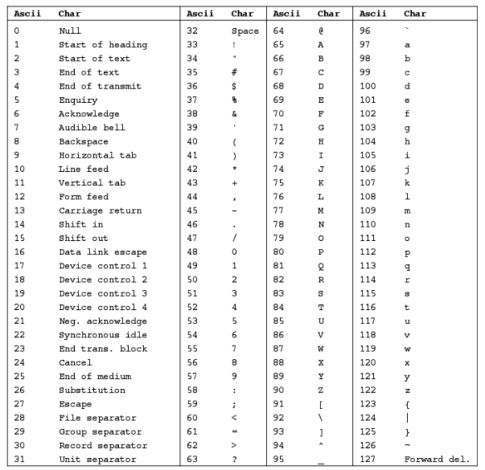  
Table 1. The ASCII Character Set. Control characters.  

--- 

#### **Delimiter**

Save tabular data in comma separated values (CSV) format. The delimiter between columns is the comma character ",".

For commas not meant to be a delimiter (e.g. used within a cell), use a vertical bar "|" or semicolon ";" instead of a comma or protect the comma with matching double quotation marks around the entire value.

This requirement is necessary for machine readability, as unprotected commas will disrupt the interpretation of columns and rows.

Examples:
- Example using a semicolon ";" instead of a comma  
&nbsp;&nbsp;&nbsp;&nbsp;Doe; Jane  
&nbsp;&nbsp;&nbsp;&nbsp;Standing water; ponded  
&nbsp;&nbsp;&nbsp;&nbsp;Area A; Area B; Area C

- Example using enclosed quotes around the cell entries containing commas   
&nbsp;&nbsp;&nbsp;&nbsp;"Doe, Jane"  
&nbsp;&nbsp;&nbsp;&nbsp;"Standing water, ponded"  
&nbsp;&nbsp;&nbsp;&nbsp;“Area A, Area B, Area C”

If data providers enter their data into programs like Microsoft Excel or Libre Office, commas that are used within cells will be detected and protected by quotation marks automatically. Data that are output from models or written in a simple text editor might need quotation marks added to text cells manually.

Example of cell entries separated by commas and protection quotes around “sunny, ponding” as viewed in a text reader (e.g., Notepad++)

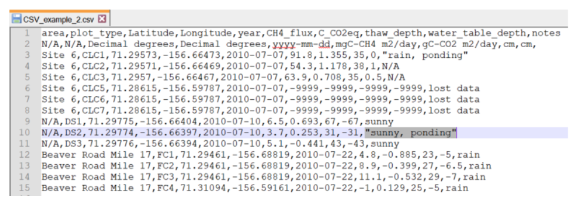

--- 

#### **Data Matrix** 

The contents of the data portion of the file must be organized in a logical and readable matrix format. There can be no empty rows and there must be the same number of columns across all of its rows.

Dataset creators may want to consider ending CSV files with a `newline` character `\n` which indicates to any CSV reader that it has read the end of the CSV file.  

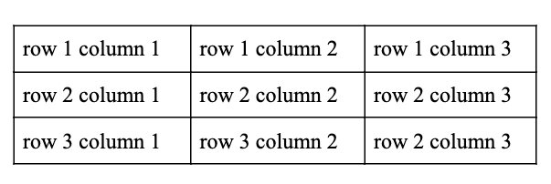  

Well formatted visualized in a spreadsheet like MS Excel 

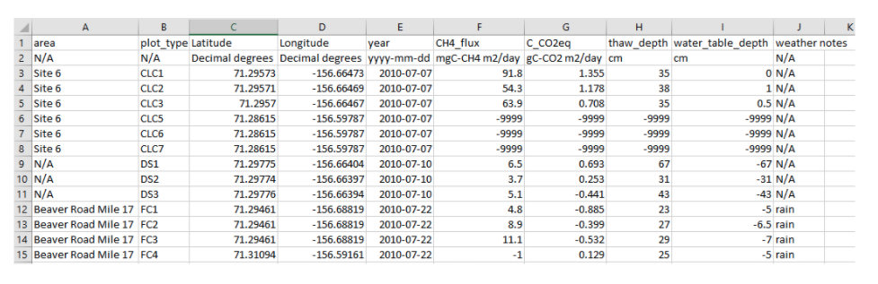  

Not well formatted visualized in a spreadsheet like MS Excel  

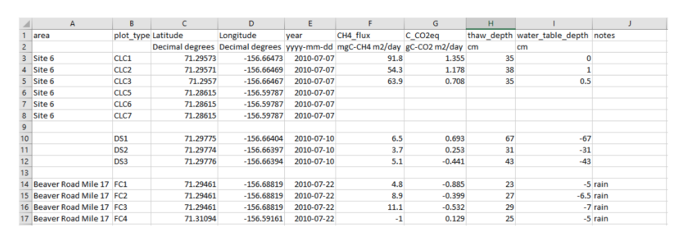  

--- 

#### **Column or Row Name Orientation**

The Data Matrix portion  (i.e., tabular data section) of each file should contain a header Column or Row following the specification in the “Column or Row Names” section of this reporting format. Column or row names may contain information about the content in the column or row.

The orientation of the Column/Row Names in the Data Matrix could be presented:  
&nbsp;&nbsp;&nbsp;&nbsp;1. Horizontally with Names at the top of each column or   
&nbsp;&nbsp;&nbsp;&nbsp;2. Vertically with Names at the start of each row.  

If following the [File Level Metadata reporting format](https://github.com/ess-dive-workspace/essdive-file-level-metadata/), we recommend that you specify the column or row name orientation within the `data_orientation` term.  

Example of Column Names presented horizontally (highlighted) visualized in a spreadsheet like MS Excel.  

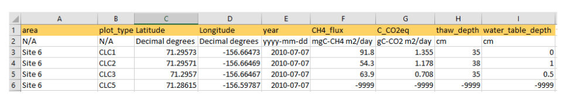  

Example of Row Names presented vertically (highlighted) visualized in a spreadsheet like MS Excel.  

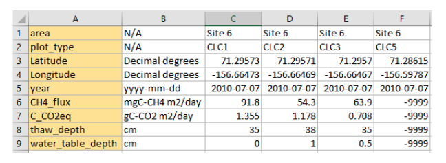  

--- 

## Naming Structure

#### **File Name**

Provide file names that are as descriptive as possible about the file contents. Use only letters (e.g., CamelCase), numbers, hyphens, and underscores "\_". Do not include spaces. Do not start with an underscore or hyphen.

Examples:  
* burned_plot_veg_2016.csv  
* SoilPoreWaterHillslope2019.csv

---

#### **Column or Row Names**

Provide unique Column or Row Names that convey basic information about the contents of each column or row. Use only letters, numbers, hyphens, and underscores. Do not include spaces and recommend not using CamelCase. Do not start with an underscore or hyphen and recommend not starting with a number.

If following the [File Level Metadata reporting format](https://github.com/ess-dive-workspace/essdive-file-level-metadata/), descriptions of the information found in each column or row should be reported and defined in the Data Dictionary file.

Examples:    
* soil_H20  
* corr_delta13C_stdev  

--- 

#### **Units**

Provide the units of measurement for the variable in one of the following ways:
- (recommended) within the `unit` term from the [File Level Metadata Reporting Format’s Data Dictionary file](https://github.com/ess-dive-workspace/essdive-file-level-metadata/blob/main/data_dictionary_dd/term_guide.md#unit)
- immediately below the Column Name as the next row or immediately adjacent to the Row Name as the next column

We recommend that you include units within the unit term in the Data Dictionary file; however, units can be included within the data file if necessary.

Example with units on a second row in the data matrix. Visualized in a spreadsheet like MS Excel.  

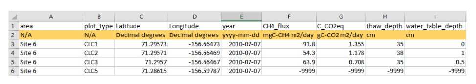  

---

## Field structure  

#### **Consistent Values**

All data within the Column or Row must use the same units of measurement. Do not mix text and numeric data within the same Column or Row.

Example of inconsistent values. The highlighted cells are inconsistent within the column by mixing in text and symbols. Visualized in a spreadsheet like MS  Excel.

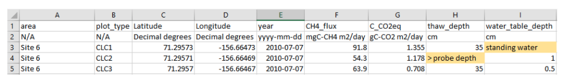   

--- 

#### **Missing Value Codes**  

All cells in the data matrix must have a value. Cells with missing data are represented with Missing Value Codes.

If you are unclear on what missing value code to use for your data, we recommend using: 
- "-9999" as the missing value code (or modify to match significant figures given the data) for Columns or Rows containing numeric data. 
- “N/A” as the missing value code for Columns or Rows containing text data.

If following the [File Level Metadata reporting format](https://github.com/ess-dive-workspace/essdive-file-level-metadata/), we recommend that you report all missing value codes in the `missing_value_code` term within the Data Dictionary file.

Example of using Missing Value Codes in highlighted cells. Visualized in a spreadsheet like MS Excel.

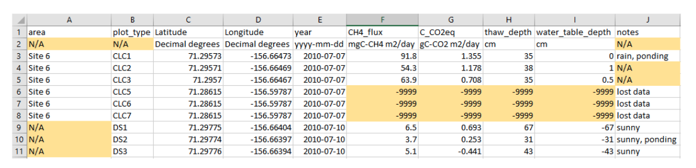  

--- 

#### **Temporal Data**

Dates must be reported in the ISO 8601:2019 standard (YYYY-MM-DD) and completed to known precision (e.g. YYYY-MM, YYYY). 

Times must be reported with a date in either Coordinated Universal Time (UTC) (YYYY-MM-DDThh:mm:ssZ) or Local Standard Time with the UTC offset (YYYY-MM-DDThh:mm±hh:mm). 

It is strongly recommended not to change UTC offset in the middle of a time series (i.e., do not switch from Standard Time to Daylight Savings Time). Complete times to known precision (e.g. YYYY-MM-DDThh). Use of "T" and either “Z” or “±” characters are required.

_YYYY = 4-digit year, MM = 2-digit month, DD = 2-digit day of month, hh = 2-digit hour ranging from 00-23, mm = 2-digit minute, ss = 2-digit second._ 

---

#### **Temporal Data Range**  
Present the range timestamped data as paired columns or rows for start and stop times (e.g., "dateTime_start" and "dateTime_end" or "time_start" and "time_end").

The Column or Row Names for timestamped data that are given as a range should specify if the measurement is the start, stop, or midpoint value, or be explained within an accompanying [Data Dictionary file](https://github.com/ess-dive-workspace/essdive-file-level-metadata/data_dictionary_dd).

---  

#### **Spatial Data**  
We recommend that spatial data be provided following the [ESS-DIVE Location Metadata reporting format](https://github.com/ess-dive-workspace/essdive-location-metadata) when possible.

In all other cases where the Location Metadata reporting format is not appropriate, the following guidance applies:
- Provide all geographic coordinates in WGS84 decimal format. Provide latitude and longitude as separate variables (i.e., in an adjacent field).
- Spatial data using different standards can be provided as a separate variable (i.e., in an adjacent field) but only in addition to WGS84 decimal format. For any coordinates not provided in WGS84, a datum must be specified within a data dictionary file.

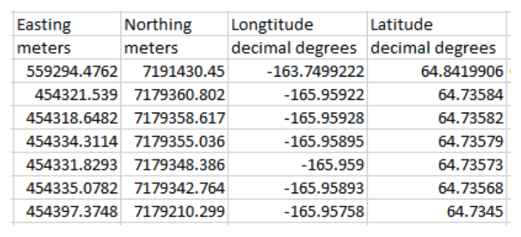  
